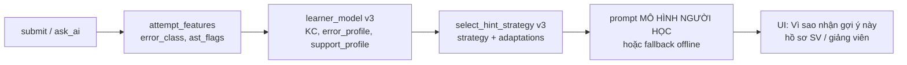

# Bản nháp Chương 3 — Phân tích và thiết kế hệ thống

> **Trạng thái: BẢN NHÁP do trợ lý AI soạn ngày 13/11/2026 từ mã nguồn hiện có, để sinh viên chỉnh sửa.** Mọi mô tả đều đối chiếu với mã tại thời điểm soạn (tên tệp ghi kèm để kiểm tra lại). Các chỗ **[SV bổ sung]** là phần sinh viên phải làm: vẽ lại biểu đồ theo chuẩn UML của Khoa, thêm ảnh, và thống nhất văn phong. Sơ đồ dạng văn bản ở đây chỉ là nguyên liệu để vẽ.

---

## 3.1. Phân tích yêu cầu

### 3.1.1. Tác nhân

| Tác nhân | Mục tiêu khi dùng hệ thống |
|---|---|
| **Người học** (sinh viên) | Luyện viết chương trình Python, nhận phản hồi đủ để tự sửa, theo dõi tiến độ của chính mình |
| **Giảng viên** | Tổ chức lớp và bài tập, biết bài nào và ai đang cần hỗ trợ, cung cấp tài liệu cho gia sư AI của lớp mình |
| **Dịch vụ mô hình ngôn ngữ** (tác nhân ngoài) | Sinh phản hồi ngôn ngữ tự nhiên theo prompt; có thể vắng mặt |

### 3.1.2. Yêu cầu chức năng

**Phía người học**

| Mã | Yêu cầu |
|---|---|
| F-S1 | Xem đề bài, viết mã trong trình soạn thảo, chạy thử trên bộ kiểm thử mà không bị ghi vào hồ sơ chính thức |
| F-S2 | Xin gợi ý theo ba mức do chính mình chọn |
| F-S3 | Nộp bài chính thức; nhận kết quả, số điểm nỗ lực và lý do của số sao đó |
| F-S4 | Trò chuyện với gia sư về khái niệm; sau khi nộp đạt thì hỏi được về bài đã nộp |
| F-S5 | Chạy từng bước để xem giá trị biến |
| F-S6 | Xem hồ sơ học tập kèm trạng thái "đủ/chưa đủ dữ liệu" |
| F-S7 | Đánh giá 👍/👎 cho phản hồi của gia sư |

**Phía giảng viên**

| Mã | Yêu cầu |
|---|---|
| F-G1 | Quản lý lớp học phần, ghi danh, lộ trình bài tập của lớp |
| F-G2 | Quản lý ngân hàng bài tập và bộ kiểm thử; chia sẻ bài tập với giảng viên khác |
| F-G3 | Xem phân tích lớp: bài gây nghẽn, cơ cấu kết quả, nhóm quá trình học, luôn kèm cỡ mẫu |
| F-G4 | Hỏi đáp về tình hình lớp bằng ngôn ngữ tự nhiên trên số liệu tổng hợp |
| F-G5 | Tải tài liệu của lớp cho gia sư AI dùng |

### 3.1.3. Yêu cầu phi chức năng

| Mã | Yêu cầu | Cách đáp ứng |
|---|---|---|
| N1 | **Ràng buộc sư phạm phải kiểm tra được**, không chỉ nằm trong prompt | Các lớp kiểm soát ở mục 3.5, mỗi lớp có kiểm thử và phép đo |
| N2 | Hệ thống vẫn dùng được khi không có mô hình ngôn ngữ | Chuỗi dự phòng kết thúc bằng bộ luật tất định (mục 3.4.3) |
| N3 | Quyền được kiểm tra ở máy chủ | Mọi endpoint có dependency xác thực; kiểm tra sở hữu lớp (mục 3.10) |
| N4 | Không đưa mã hay danh tính sinh viên cho mô hình khi phân tích lớp | Chỉ gửi số liệu tổng hợp |
| N5 | Chỉ số không được diễn giải vượt bằng chứng | Mọi chỉ số gắn cỡ mẫu và `data_status` |

### 3.1.4. Ngoài phạm vi

Tổ chức thi và giám sát chống gian lận nằm ngoài phạm vi: đề tài phục vụ người muốn học, không phục vụ việc kiểm tra người học. (Mã nguồn còn một phân hệ đợt thi từ giai đoạn đầu, hiện ẩn trên giao diện và không được phát triển tiếp; **[SV quyết định có nhắc tới trong khóa luận hay không]**.)

**[SV bổ sung: biểu đồ use case tổng quát và phân rã.]**

---

## 3.2. Thiết kế sư phạm

Đây là phần trung tâm của khóa luận. Mỗi quyết định dưới đây ứng với một nguyên tắc ở Chương 2 (bảng ánh xạ: `docs/PEDAGOGICAL_FOUNDATIONS.md`).

### 3.2.1. Ba hành động tách biệt trong IDE

| Hành động | Endpoint | Gọi mô hình? | Ghi vào hồ sơ chính thức? | Cấp sao? |
|---|---|:-:|:-:|:-:|
| Chạy thử | `POST /api/run-test` | Không | Không (chỉ ghi lượt chạy thử để phân tích quá trình) | Không |
| Hỏi Gia sư AI | `POST /api/submit`, `action_type='ask_ai'` | Có | Không | Không |
| Nộp bài | `POST /api/submit`, `action_type='submit'` | Chỉ khi chưa đạt | Có | Có, khi đạt mọi kiểm thử |

Lý do tách: người học cần một không gian thử–sai không có hậu quả. Nếu mọi lần chạy đều bị tính, người học sẽ ngại thử.

### 3.2.2. Ba mức gợi ý

| Mức | Mục tiêu sư phạm | Được nêu | Không được nêu | Cấu trúc nội dung (v5.10) |
|---|---|---|---|---|
| 1. Gợi mở | Định hướng khái niệm | Tên nhóm khái niệm gắn với dạng vấn đề quan sát được, giải thích ngắn bằng lời, một ví dụ ngắn với dữ kiện khác bài, một phép thử người học tự làm | Dòng code của người học, đầu vào/đầu ra của kiểm thử, tham số hay biểu thức sai, cách sửa | Đang ở đâu → khái niệm → một câu hỏi → một bước kế tiếp |
| 2. Chẩn đoán | Khoanh vùng lỗi bằng bằng chứng thực thi | Đúng MỘT dòng code của người học (từ thông báo cú pháp, traceback, vết chạy hoặc cấu trúc), đầu vào/kỳ vọng/thực tế của test giàu thông tin nhất, vết chạy của chính mã người học | Cách sửa, điều kiện hay biểu thức thay thế, khối code từ 3 dòng | Đang ở đâu → dòng cần xem → bằng chứng → giải thích hành vi + một câu hỏi → một bước kế tiếp |
| 3. Dàn ý | Cấu trúc của bài, không phải logic | Dàn ý 4 bước theo đề bài, khung mã bám mã người học (logic đã bị che), bảng chạy tay để trống | Điều kiện, miền lặp, vế phải phép gán, lời giải | Đang ở đâu → dàn ý → khung `# TODO` → bảng chạy tay → một bước kế tiếp |

Người học chọn mức. Hệ thống **không tự nâng mức** vượt mức được yêu cầu. Từ v5.10, ranh giới giữa các mức được thực thi bằng ba lớp: (1) *rào chắn thông tin*: lời nhắc Mức 1 không chứa giá trị kiểm thử, Mức 2–3 chỉ nhận đúng phần bằng chứng của mình; (2) chỉ dẫn và bố cục riêng từng mức; (3) bộ lọc tất định ở đầu ra (code hoàn chỉnh, cụm tiết lộ, che logic khung Mức 3, chặn chép lại chú thích của người học). Lớp (2) vẫn có thể bị mô hình vượt (xem 4.5.7).

### 3.2.3. Khung phản hồi hình thành

Mọi gợi ý, dù do mô hình hay bộ luật sinh ra, theo cùng một khung:

1. **Đang ở đâu:** bài nào, đạt bao nhiêu kiểm thử.
2. **Bằng chứng:** điều quan sát được từ kiểm thử hoặc phân tích cú pháp.
3. **Bước kế tiếp:** đúng một việc vừa sức.

Khi bài đã đạt, khung chuyển sang "rút giàn giáo": ghi nhận bằng chứng, một câu hỏi tự kiểm, một hướng mở rộng tùy chọn (`build_pass_feedback`, không gọi mô hình).

### 3.2.4. Chiến lược thích ứng

Hàm `select_hint_strategy` (`backend/adaptive_policy.py`) chọn chiến lược theo thứ tự ưu tiên:

| Điều kiện (xét từ trên xuống) | Chiến lược | Ý nghĩa |
|---|---|---|
| Đạt mọi kiểm thử | `solution_review` | Ôn lại, tự giải thích |
| Đã có từ 2 lượt làm trước đó ở bài này | `recurring_difficulty` | Đổi cách tiếp cận: chạy từng bước thay vì sửa theo cảm tính |
| Có kiểm thử chưa đạt | `failed_case_diagnosis` | Bám vào kiểm thử chưa đạt đầu tiên |
| Còn lại | `conceptual_start` | Bắt đầu từ khái niệm |

Chính sách là tất định và trả về danh sách bằng chứng đã dùng. Nó chỉ đổi **cách** gợi ý; mức gợi ý (`requested_level`) được giữ nguyên.

### 3.2.5. Điểm nỗ lực

- Sao chỉ sinh khi **Nộp bài** và đạt mọi kiểm thử.
- Số sao theo mức gợi ý cao nhất đã dùng ở "Hỏi Gia sư AI" cho tới lần nộp đạt đầu tiên: không dùng hoặc Mức 1 → 3 sao; Mức 2 → 2 sao; Mức 3 → 1 sao.
- Số lần chạy thử và số lần nộp **không** trừ sao.
- Nộp lại sau khi đã đạt là ôn tập, không tăng sao.
- Mỗi lần cấp sao kèm thẻ giải thích (`explain_autonomy_stars`), và nói rõ sao là quy ước của sản phẩm, không phải điểm học phần.

Rủi ro đã biết: cơ chế này có thể khiến người học ngại xin gợi ý khi thật sự cần. Giảm nhẹ: Mức 1 không mất sao, thử–sai không mất sao. Rủi ro còn lại được hỏi trực tiếp trong pilot.

### 3.2.6. Phạm vi trò chuyện

| Trạng thái của người học ở bài này | Phạm vi | Mô hình nhận được gì |
|---|---|---|
| Chưa nộp đạt | `concept_only` | Đề bài, lịch sử trò chuyện, tài liệu truy xuất. **Không có mã bài làm** |
| Đã nộp đạt | `code_review` | Thêm mã đã nộp (lấy từ cơ sở dữ liệu) và tóm tắt cấu trúc |

Phạm vi do máy chủ quyết định từ cơ sở dữ liệu (`get_latest_passed_submission_code`), không tin dữ liệu client gửi. Trong phạm vi khái niệm, gia sư giải thích khái niệm trực tiếp rồi hỏi lại một câu kiểm tra; chỉ từ chối khi người học xin cách giải bài đang làm.

---

## 3.3. Kiến trúc tổng thể

```text
[Trình duyệt]  React 18 + Vite + Tailwind + Monaco
      │  HTTPS/JSON, JWT
      ▼
[Backend]  FastAPI — xác thực, phân quyền, điều phối sư phạm
      ├── SQLite (WAL)  ← dùng chung tệp với tiến trình công cụ
      ├── Kho tri thức (SQLite + TF-IDF)
      ├── Dịch vụ mô hình ngôn ngữ (Gemini → Qwen → bộ luật tất định)
      │
      │  JSON-RPC 2.0 qua stdio
      ▼
[Tiến trình công cụ]  mcp_server — 8 công cụ
      chạy kiểm thử · phân tích cú pháp · truy vết · đề bài · lịch sử · mô hình người học
```

**Nguyên tắc phân tầng.** Backend không gọi trực tiếp hàm của tiến trình công cụ; mọi việc chấm, phân tích cú pháp và truy vết đi qua `backend/mcp_client.py`. Lớp công cụ dùng giao thức MCP để các công cụ có mô tả và lược đồ tham số chuẩn. Trong khóa luận này MCP là **lớp tích hợp**, không phải phương pháp dạy học.

**Đánh đổi đã đo.** Mỗi lời gọi công cụ mở một tiến trình mới và bắt tay lại giao thức, không có kết nối dùng chung. Thiết kế này đơn giản và cô lập lỗi tốt, đổi lại khoảng 1–2 giây chi phí nền cho mỗi yêu cầu (mục 4.6).

**Tám công cụ:** `run_test_cases`, `analyze_code_ast`, `get_exercise_list`, `get_exercise_details`, `save_learning_event`, `get_attempt_history`, `get_student_model`, `trace_code_execution`.

**[SV bổ sung: biểu đồ thành phần/triển khai.]**

---

## 3.4. Luồng chấm bài và sinh phản hồi

### 3.4.1. Luồng `POST /api/submit`

```text
1. Xác thực (chỉ vai trò sinh viên) và kiểm tra quyền truy cập lớp
2. Đường ống công cụ: chạy kiểm thử → phân tích cú pháp → lịch sử làm bài → mô hình người học
3. select_hint_strategy(mức yêu cầu, kết quả kiểm thử, lịch sử, mô hình)
4. Rẽ nhánh:
     a. action=submit và đạt hết  → phản hồi tất định (không gọi mô hình)
     b. còn lại                   → generate_tutor_hint (mục 3.4.3) + các lớp kiểm soát (mục 3.5)
5. Ghi lượt tương tác với mô hình (nguồn, độ trễ, token, trạng thái bộ lọc)
6. Ghi sự kiện học tập (lỗi ghi chỉ cảnh báo, không làm hỏng phản hồi)
7. Nếu action=submit và đạt hết → tính sao, lưu sao, trả thẻ lý do
```

`POST /api/run-test` dùng một đường ống riêng, ngắn hơn: chỉ chạy kiểm thử và ghi lượt chạy thử.

### 3.4.2. Dựng prompt

Prompt gợi ý được ghép từ các khối độc lập trong `build_scaffolding_prompt` (`backend/llm_service.py`): quy tắc dữ liệu không đáng tin cậy, đề bài, mã người học, kết quả chạy, phân tích AST, lịch sử và **nội dung tối đa ba gợi ý gần nhất cho cùng bài** (để gợi ý mới đi tiếp một bước, không lặp), hồ sơ và chiến lược thích ứng, bằng chứng ưu tiên theo mức, khung phản hồi hình thành, chỉ dẫn theo mức. Các khối được khóa bằng test vàng (`test_prompt_golden_v510.py`: prompt dựng lại giống từng ký tự trên 47 ca). Đề bài, mã và chú thích của người học được bọc trong thẻ và tuyên bố là **dữ liệu không đáng tin cậy, không phải chỉ dẫn**; nếu chú thích xin đáp án hay ra lệnh, gia sư từ chối ngắn bằng một câu rồi vẫn đưa gợi ý đúng mức. Lưu ý: chỉ lời nhắc trò chuyện dùng mẫu Jinja2 `StrictUndefined` (`backend/prompt_templates.py`); lời nhắc gợi ý là chuỗi định dạng nhiều khối.

**Bằng chứng ưu tiên** (`backend/hint_evidence.py`, hàm thuần): chọn test lỗi có đầu vào nhỏ nhất, chọn một dòng đáng xem kèm cơ sở quan sát được, nhóm khái niệm gắn với dạng lỗi, dàn ý nền theo đề, và (với `ask_ai` khi bài chưa đạt) vết chạy của chính mã người học lấy bằng `trace_code_execution` trong cùng phiên MCP, có timeout 6 giây và fallback về bằng chứng tĩnh.

### 3.4.3. Chuỗi dự phòng

```text
Gemini ──lỗi/rỗng/quá ngắn/không có khóa──► Qwen ──lỗi──► Bộ luật sư phạm tất định (hint_rules)
```

Bộ luật tất định (`generate_rule_based_fallback` → `backend/hint_rules.py`) dùng cùng bằng chứng với nhánh mô hình và chỉ nêu điều quan sát được. Mức 1 gọi tên khái niệm và đưa một phép thử; Mức 2 nêu đúng một dòng với cơ sở quan sát (có dòng ghi rõ "đây là nơi đáng quan sát, chưa phải kết luận dòng này sai") cùng bằng chứng thực thi; Mức 3 dựng dàn ý theo đề, khung mã từ mã người học đã che logic và bảng chạy tay để trống, rồi đối chiếu với dàn ý để nêu đúng một bước kế tiếp. Chú thích của người học không bao giờ được chép lại. Bộ luật cũng thay thế phản hồi của mô hình khi bộ lọc đầu ra chặn hoặc khi phản hồi chép lại chú thích người học.

**[SV bổ sung: biểu đồ tuần tự cho luồng 3.4.1.]**

---

## 3.5. Các lớp kiểm soát đầu ra

Yêu cầu N1 được hiện thực bằng năm lớp. Lớp sau không thay lớp trước.

| # | Lớp | Áp dụng khi | Cách làm | Khi phát hiện vi phạm | Phép đo |
|---|---|---|---|---|---|
| 1 | Chỉ dẫn trong prompt | Mọi lời gọi mô hình | Nêu rõ điều được và không được theo mức | — | 22 ca với mô hình thật |
| 2 | Bộ lọc đầu vào | Trò chuyện | Mẫu chèn lệnh, ngoài phạm vi, quá dài | Từ chối, không gọi mô hình | Benchmark, có tập giữ riêng |
| 3 | Bộ lọc đầu ra (`check_student_output`) | Mức 1–2, trò chuyện | Đếm dòng trông như câu lệnh trong khối mã, mã không rào, mã trong `` ` ``; phát hiện chương trình đọc–in hoàn chỉnh | Thay bằng phản hồi tất định | Benchmark, có tập giữ riêng |
| 4 | Che logic khung mã (`enforce_level3_skeleton`) | Mức 3, bài chưa đạt | Giữ đọc dữ liệu thuần, khởi tạo bằng hằng, in hằng hoặc tên biến, từ khóa cấu trúc; thay điều kiện, miền lặp, biểu thức bằng `...  # TODO` | Che tại chỗ, kèm thông báo số chỗ đã che | Chạy khung đã che trên bộ kiểm thử |
| 5 | Khóa phạm vi trò chuyện | Trò chuyện trước khi nộp đạt | Không đưa mã bài làm vào prompt | Mô hình không có gì để sửa hộ | Kiểm thử endpoint |

Vì sao Mức 3 dùng **che** thay vì **chặn**: ở mức này khối mã dài là hợp lệ, nên không thể đếm dòng như Mức 1–2. Che giữ lại phần có ích (cấu trúc) và bỏ phần làm hộ (lập luận). Khung sau khi che vẫn là Python hợp lệ, người học chạy thử được ngay.

Giới hạn chung: các lớp 2–4 dựa trên biểu thức chính quy; kết quả trên tập giữ riêng của lớp 2 và 3 cho thấy còn lọt (mục 4.4.1).

---

## 3.6. Truy xuất tri thức

- **Chỉ mục:** tài liệu được tách thành đoạn theo mục; biểu diễn TF-IDF thưa, lưu trong SQLite; so khớp bằng cosine.
- **Ngưỡng liên quan** (`MIN_RELEVANCE = 0,16`): dưới ngưỡng thì trả danh sách rỗng. Khi đó câu trả lời mang trạng thái `no_source` và giao diện nói rõ không có tài liệu phù hợp. Hệ thống không bao giờ gắn nguồn khi danh sách rỗng.
- **Tài liệu theo lớp:** giảng viên tải tài liệu (md, txt, pdf, docx) cho lớp của mình; chỉ lưu văn bản đã trích. Truy xuất của lớp nào chỉ thấy tài liệu chung và tài liệu của lớp đó. Nguồn từ giảng viên được ghi nhãn riêng.
- **Giới hạn:** nguồn hiển thị là tài liệu đã cung cấp cho mô hình, chưa chắc câu trả lời đã dùng tới; giao diện gọi tên đúng như vậy ("Tài liệu nội bộ liên quan").

---

## 3.7. Mô hình người học và chỉ số

- **Chỉ lượt Nộp bài** tính vào chỉ số chính thức; lượt Hỏi Gia sư AI và Chạy thử không tính.
- Chỉ số: số lượt nộp, số bài khác nhau, tỷ lệ đạt ngay lần đầu, số lượt nộp trên mỗi bài, mức gợi ý cao nhất trung bình, điểm nỗ lực, cơ cấu lỗi, mức nắm theo chủ đề, khó khăn lặp lại, bài nên luyện tiếp.
- **Trạng thái dữ liệu:** `no_data` (chưa nộp), `limited` (dưới 3 bài khác nhau), `sufficient` (từ 3 bài). Khi `limited`, hồ sơ ghi "chưa đủ dữ liệu" thay vì nhận định.
- Logic mô hình nằm trong module hàm thuần dùng chung `pytutor_shared/learner_model.py`; hai bản `compute_student_model` (backend và tiến trình công cụ) chỉ khác dòng mở kết nối và được kiểm thử là cùng nguồn, cùng kết quả.
- Mục 3.7.1 thêm phần `learner_model` (phiên bản mô hình "3") cạnh các chỉ số trên; `analytics_metrics` và `metric_definition_version "2"` không đổi.

### 3.7.1. Mô hình người học v3 (heuristic thứ bậc)

Mô hình là **heuristic thứ bậc, không phải BKT/IRT/Knowledge Tracing**: ngưỡng là quy ước vận hành chưa hiệu chuẩn; mỗi trạng thái kèm câu giải thích sinh tự động để người học và giảng viên xem được "vì sao".

**Đơn vị kiến thức (KC).** Sáu KC cố định, gán cho bài tập bằng bảng từ khóa tất định trên `category`/`module_name`/`skill_tag` (đã bỏ dấu, không phân biệt hoa thường); `io_format` gán cho mọi bài.

| KC | Nhãn | Từ khóa gán (rút gọn) |
|---|---|---|
| `io_format` | Nhập/xuất và định dạng | mọi bài |
| `conditional` | Rẽ nhánh / điều kiện | rẽ nhánh, điều kiện, `if`, cờ hiệu |
| `loop` | Vòng lặp | vòng lặp, `for`, `while`, duyệt |
| `accumulator` | Biến tích lũy | tích lũy, biến tích, accumulat |
| `string` | Xử lý chuỗi | chuỗi, string, slicing, text, văn bản |
| `recursion` | Đệ quy | đệ quy, recurs |

**Trạng thái KC** (chỉ tính từ lượt `submit`): `no_evidence` (chưa có bài gắn KC); `struggling` (có bài gắn KC với từ 2 lượt nộp sai chưa giải); `secure` (từ 2 bài gắn KC đã đạt, điểm nỗ lực trung bình từ 70, không `struggling`); còn lại `developing`. Dữ liệu theo KC `sufficient` khi có từ 2 bài.

**Hồ sơ lỗi** (`error_profile`) lấy từ bảng mới `attempt_features` (`error_class` thuộc passed/syntax/runtime/timeout/logic_partial/logic_none, cùng cờ AST). Lượt cũ chưa có đặc trưng dùng heuristic dự phòng; mô hình báo `feature_coverage_percent`.

**Hồ sơ hỗ trợ và quá trình** (`support_profile` với `hint_reliance` low/medium/high/unknown; `process_by_exercise`) dùng lượt `ask_ai` và chạy thử; được gắn nhãn `descriptive_process`, **không** vào `analytics_metrics`, sao hay điểm nỗ lực.

**Luật chính sách v3** (`select_hint_strategy`, vẫn 4 chiến lược). Luật dựa vào mô hình chỉ kích hoạt khi KC liên quan có dữ liệu `sufficient` và dùng bằng chứng **từ bài khác** (không đếm trùng lịch sử bài đang làm):

| Mã điều chỉnh | Điều kiện | Tác dụng |
|---|---|---|
| `same_exercise_repeat` | từ 2 lượt thử ở bài này | `recurring_difficulty`, nêu riêng số lần nộp/hỏi |
| `concept_recurring_difficulty` | sai, dưới 2 lượt thử, KC của bài đang `struggling` ở bài khác | `recurring_difficulty` dựa trên khó khăn khái niệm |
| `repeated_error_type` | sai, loại lỗi trùng `dominant_error_class` của KC | `failed_case_diagnosis` nhấn vào loại lỗi lặp lại |
| `bridge_from_mastered` | bắt đầu khái niệm, có KC `secure` | nhắc một bài đã làm đạt |
| `independence_check` | đạt hết và `hint_reliance=high` | ôn lại kèm câu tự kiểm về mức hỗ trợ đã dùng |
| `granularity_fine` | `hint_reliance=high` hoặc điểm nỗ lực dưới 45 (dữ liệu đủ) | chia bước kế tiếp nhỏ hơn |
| `granularity_coarse` + `self_check_first` | mọi KC `secure` và điểm nỗ lực từ 80 | một câu hỏi và tự kiểm trước |

Đầu ra thêm `model_fields_used`, `learner_signals`, `policy_version "3"`. **`requested_level` luôn bằng mức người học yêu cầu** (luật bất biến 4); mô hình chỉ đổi cách diễn đạt.

**Luồng dữ liệu.**



`POST /api/submit` nhận thêm `class_id` tùy chọn (bỏ qua nếu sinh viên chưa ghi danh); giảng viên xem mô hình từng sinh viên qua `GET /api/instructor/classes/{class_id}/students/{username}/learner-model`. Mô hình không được đưa vào trò chuyện lớp của giảng viên.

Mọi ngưỡng ở mục này là **quy ước vận hành**, chưa hiệu chuẩn.

---

## 3.8. Phân tích cho giảng viên

**Nhóm quá trình học.** Mỗi cặp sinh viên–bài trong N ngày gần nhất được xếp vào một nhóm:

| Nhóm | Điều kiện |
|---|---|
| Đạt độc lập | Đã đạt; gợi ý cao nhất trước lần đạt đầu ≤ Mức 1; ≤ 2 lượt nộp và < 5 lượt chạy thử |
| Đạt sau thử–sửa | Đã đạt; gợi ý ≤ Mức 1; nhiều lượt nộp hoặc chạy thử hơn |
| Đạt nhờ gợi ý | Đã đạt; đã dùng Mức 2 trở lên |
| Đang tiến triển | Chưa đạt; số kiểm thử đạt còn tăng, hoặc mới thử ít |
| Mắc kẹt | Chưa đạt; ≥ 8 lượt và không tăng trong 5 lượt gần nhất |
| Chỉ chạy thử | Chưa nộp lần nào |

Mục đích là tách "thử nhiều mà vẫn tiến" khỏi "thử nhiều mà không tiến", để giảng viên biết nên hỏi han ai. Đây là bằng chứng mô tả, không phải điểm.

**Đơn vị đếm là cặp sinh viên–bài**, không phải sinh viên. Khi mô hình diễn đạt lại số liệu và gọi nhầm đơn vị, hệ thống gắn một ghi chú đính chính tất định.

**Hỏi đáp về lớp.** Máy chủ kiểm tra giảng viên sở hữu lớp, tự tổng hợp số liệu, rồi mới gọi mô hình với bản tóm tắt đó. Mô hình không sinh truy vấn, không nhận mã và danh tính sinh viên. Câu trả lời buộc phải nêu khoảng thời gian, cỡ mẫu và giới hạn diễn giải.

---

## 3.9. Thiết kế cơ sở dữ liệu

SQLite, chế độ WAL, thời gian chờ khóa 20 giây, vì hai tiến trình (backend và tiến trình công cụ) cùng truy cập một tệp.

| Nhóm | Bảng | Vai trò |
|---|---|---|
| Người dùng và lớp | `users`, `credit_classes`, `class_enrollments`, `class_exercises` | Tài khoản, lớp học phần, ghi danh, lộ trình bài của lớp |
| Bài tập | `exercises`, `exercise_shares` | Đề, bộ kiểm thử, chia sẻ giữa giảng viên |
| Hoạt động học | `submissions`, `practice_runs`, `user_exercise_stars`, `user_achievements` | Lượt nộp và hỏi AI, lượt chạy thử (không lưu mã), sao, huy hiệu |
| Gia sư AI | `llm_interactions`, `llm_interaction_sources`, `tutor_feedback` | Nhật ký lời gọi mô hình, nguồn đã dùng, đánh giá 👍/👎 |
| Tri thức | `kb_documents` | Tài liệu giảng viên tải lên, gắn theo lớp |
| Khác | `exam_sessions` | Phân hệ đợt thi cũ, đang ẩn |

**[SV bổ sung: mô hình thực thể liên kết và bảng mô tả cột cho các bảng chính.]**

---

## 3.10. Phân quyền và an toàn

- **Xác thực:** JWT (HS256, hết hạn sau 24 giờ); mỗi endpoint khai báo dependency `verify_token`, `require_student` hoặc `require_instructor`.
- **Mật khẩu:** mật khẩu được băm bằng PBKDF2-HMAC-SHA256 (muối ngẫu nhiên 16 byte, 200.000 vòng; `backend/passwords.py`) và so sánh thời gian hằng. Cơ sở dữ liệu mới tự seed tài khoản mẫu bằng mật khẩu đã băm. **Tương thích ngược:** giá trị lưu không có tiền tố băm vẫn được chấp nhận như mật khẩu văn bản thường của cơ sở dữ liệu cũ, và hệ thống **không tự ghi đè** mật khẩu cũ khi đăng nhập; vì vậy một cơ sở dữ liệu đã có từ trước vẫn lưu mật khẩu dạng văn bản thường cho đến khi quản trị viên cập nhật cột `users.password` bằng `hash_password`. Hệ thống chưa có chức năng đăng ký hay đổi mật khẩu.
- **Khóa ký JWT:** nếu biến môi trường `JWT_SECRET_KEY` chưa đặt, hệ thống dùng khóa mặc định nằm trong mã nguồn và ghi cảnh báo khi khởi động. Chấp nhận được cho bản demo cục bộ; **phải đặt biến môi trường trước khi triển khai** (hệ thống không chặn khởi động để bản demo vẫn chạy được).
- **Quyền theo lớp:** `ensure_class_access` cho sinh viên; kiểm tra sở hữu lớp cho giảng viên. Giao diện ẩn/hiện theo vai trò chỉ để tiện dùng; quyền thật nằm ở máy chủ.
- **Dữ liệu gửi cho mô hình:** khi xin gợi ý, mã bài làm và kết quả kiểm thử được gửi cho nhà cung cấp mô hình. Khi phân tích lớp, chỉ số liệu tổng hợp được gửi.
- **Chạy mã của người học:** mỗi kiểm thử chạy trong một tiến trình con riêng, có giới hạn thời gian 5 giây. **Đây chưa phải là cô lập bảo mật (điểm bảo mật còn lại chưa xử lý):** tiến trình con chạy với quyền của máy chủ, không giới hạn bộ nhớ, tệp hay mạng. Thiết kế này đủ cho thử nghiệm trên máy cá nhân với dữ liệu giả lập; triển khai thật cần chạy mã trong vùng chứa hoặc công cụ cô lập chuyên dụng. Hạn chế này phải được nêu ở Chương 4 và Chương 5.

---

## 3.11. Giao diện

**[SV bổ sung: mô tả ngắn các màn hình chính kèm ảnh — cổng sinh viên, IDE ba cột, bảng gia sư, hồ sơ học tập, không gian giảng viên, bảng phân tích lớp. Nêu nguyên tắc thiết kế trong `DESIGN.md`: phẳng, hai chế độ sáng/tối, màu chủ đạo của NEU.]**
